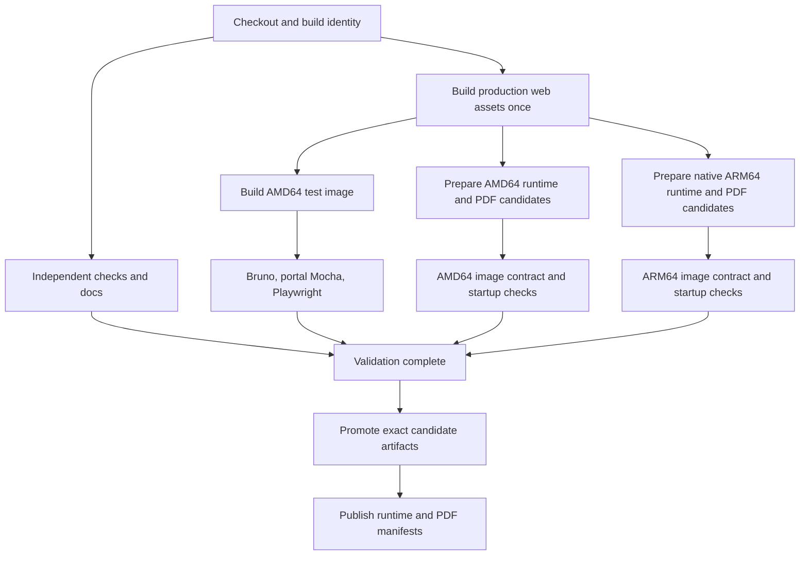

# CircleCI performance implementation plan

Status: implementation in progress on `chore/circleci-performance`. The baseline
and targets below are retained as the original plan. The first scheduling pilot
and its partial results are recorded in [pilot-13582.json](pilot-13582.json).
Prepared image and asset changes still require integration and acceptance; the
targets have not been demonstrated.

Source checkout: `6e9f227e7e4401ba64457ea7c54802b0da19f692` (`develop`).
Evidence collected on 31 October 2026, Australia/Adelaide.

## Goal and completion criteria

Reduce the time developers wait for the existing validation suites, and reduce
the time to publish both architectures and both runtime variants. Preserve test
coverage, package dependency graphs, and the requirement that publication waits
for successful validation.

| Metric | Observed median | Implementation target |
| --- | --- | --- |
| All tests and API documentation checks complete | 25m 09s | At most 12 minutes on routine source changes with primed caches |
| Full `develop` workflow, including both image manifests | 46m 13s | At most 20 minutes median and 25 minutes p90 with primed caches |
| Independent package and Angular checks complete | Currently held behind the initial image build | At most 5 minutes median from workflow creation |
| Full workflow with dependency, Docker, and asset caches empty | Not established by the historical sample | At most 30 minutes in each of three controlled cold runs |
| Correctness | Current suites and reports | Every expected suite runs; image smoke checks and publication failure gates pass |
| Cost | Billing data not available through the public APIs used here | Median credits per successful workflow no more than 10% above the matched baseline; record failed and canceled workflow costs separately |

These are acceptance targets, not measured improvements. A 20-minute full run
would reduce the observed median by about 57%; a 12-minute check result would
reduce the observed median by about 52%.

Measure from workflow creation, so queuing, executor setup, artifact transfer,
and publishing remain visible. Also report execution time separately. Keep
release-tag/npm-publish workflows as a separate cohort: this baseline covers
`develop` image publishing, not npm package publication or master-only wiki jobs.

Accept the final implementation after at least ten successful, representative
source-changing warm runs across multiple commits, three controlled cold runs,
and the failure/packaging checks below. Ten runs provide a provisional p90;
reassess it after 30 routine runs. Do not count repeatedly rebuilding unchanged
source as the entire warm cohort. Include backend-only, Angular-only,
shared-library, and mixed changes. Test dependency/lockfile changes separately.

## Evidence and limits

[baseline.json](baseline.json) contains sanitized API measurements, job numbers,
source revisions, Docker stage durations, and the scheduling replay. It excludes
credentials, signed console-output URLs, and full application logs.

The sample is the latest 12 `develop` pipelines returned by the public CircleCI
API at collection time: eight succeeded, three failed, and one was canceled.
Successful runs supply duration comparisons; failures and cancellation are
retained in the sampling record, rather than counted as fast successful runs.
The sample does not classify the failures as flaky tests or infrastructure faults.

| Pipeline | All checks | Full publishing |
| --- | --- | --- |
| 13568 | 23m 36s | 42m 46s |
| 13529 | 29m 54s | 52m 10s |
| 13519 | 26m 04s | 46m 11s |
| 13476 | 26m 06s | 46m 15s |
| 13455 | 24m 26s | 43m 32s |
| 13441 | 25m 34s | 49m 42s |
| 13439 | 24m 11s | 42m 43s |
| 13391 | 24m 44s | 48m 11s |

“All checks” means the last completion of every `test-*` job plus
`generate-api-docs`, even when the existing publish dependency list omits one of
those checks. Full publishing means workflow completion.

Across the eight successes:

| Job | Median | Observed range |
| --- | --- | --- |
| Initial `build` | 16m 45s | 15m 30s–18m 41s |
| `build-runtime-pdfgen` | 11m 36s | 11m 24s–15m 35s |
| `test-mocha` | 6m 56s | 6m 39s–7m 09s |
| `test-playwright` | 6m 30s | 6m 10s–6m 52s |
| `test-redbox-core` | 3m 59s | 3m 48s–4m 06s |
| `test-angular-form` | 3m 32s | 3m 26s–4m 06s |
| `deploy-arm64` | 13m 00s | 12m 45s–13m 58s |
| `deploy-runtime-pdfgen-arm64` | 14m 13s | 13m 32s–14m 58s |

These durations overlap; adding the medians is not a valid workflow estimate.
The existing dependency graph makes the initial image, PDF preparation, and
ARM64 PDF build largely sequential. Inspect the
[representative workflow](https://app.circleci.com/pipelines/github/redbox-mint/redbox-portal/13568/workflows/11433aad-8849-4ace-892f-cd0a07d26d30)
and [initial build log](https://circleci.com/gh/redbox-mint/redbox-portal/199020).

The representative initial image build took 12m 48s. Inside it:

| Docker operation | Measured time |
| --- | --- |
| Production Angular builds, including Angular install | 3m 40s |
| Webpack | 1m 31s |
| Snapshot development dependency directories | 1m 56s |
| Remove development dependency directories and reinstall production graph | 1m 31s |
| Compile redbox-core | 14 seconds |

Saving the image and persisting its archive added another 2m 01s outside the
Docker build. Four initial-build logs confirm the same expensive operations;
the dependency-copy duration varies substantially. In the representative ARM64
builds, Angular took approximately 4m 26s–4m 30s and webpack approximately
2m 58s–3m 00s, repeated for each variant.

A DAG replay removing only the PDF image job's dependency on `build` gives a
median modeled saving of 5m 02s across eight runs, with modeled full completion
around 41m 09s. It preserves observed job durations and ready-to-start delays.
This is a counterfactual, not a benchmark: starting more jobs earlier can change
executor contention. The observed initial scheduling delay ranged from 17
seconds to 5m 19s, so concurrency and queue time must be measured explicitly.

## Findings that determine the design

1. **Most checks wait for an image they do not use.** Angular tests, docs,
   agenda, RVA, dev-tools, storage, core, and sails-ng-common prepare their own
   dependencies. Some attach the image workspace without loading the image.
   The image-dependent jobs are Bruno, portal Mocha, and Playwright. Starting
   independent checks earlier improves feedback; it does not by itself remove
   the integration-test critical path.
2. **The Dockerfile mixes test and production dependency preparation.** Its
   common builder snapshots development dependencies even for production
   targets, then removes them for a production reinstall. The test target
   derives from production runtime and restores the snapshot. Separate stage
   branches can remove that round trip while retaining the production graph.
3. **Common source work is rebuilt for every image variant.** The test, PDF,
   ARM64 runtime, and ARM64 PDF jobs repeat Angular and webpack. ARM64 is already
   native (`arm.medium`); replacing emulation is not an available saving.
4. **Persistent Docker reuse is not configured.** `COPY . .` occurs before
   dependency installs. A source change invalidates all subsequent layers, and
   the commands do not import/export a shared BuildKit cache. The host's cached
   `~/.npm` is not automatically available to a remote Docker build. Existing
   evidence supports repeated work; actual cache hit rates still need telemetry.
5. **Integration startup repeats asset preparation.** Both Mocha and Playwright
   scripts call `npm run webpack`; Playwright may build Angular if assets are
   absent. The Mocha host job also compiles backend packages before using the
   image. Determine which host artifacts are actually consumed before removing
   these builds. Source inspection establishes duplication, not an exact saving.
6. **The Angular test matrix repeats preparation.** Each of its 19 jobs
   installs root dependencies, calls the production Angular helper twice to
   build shared libraries, and the test helper installs Angular dependencies
   again. Each production helper call runs `npm ci`. A common preparation
   artifact or one install per job is a candidate after the main critical path.
7. **Existing publishing semantics need explicit contracts.** Automatic AMD64
   deployment pushes `redbox-portal:test`; ARM64 deployment builds `runtime`.
   The Dockerfile identifies `runtime` as pristine and `test` as including demo
   hooks and development dependencies. Treat the intended runtime content as a
   correctness decision in its own reviewed change, not an incidental speed edit.
8. **Existing validation gates are inconsistent.** Normal Docker deployment
   does not list Playwright, RVA, or docs as dependencies; release workflows also
   differ in enabled jobs. `develop` branch protection currently requires the
   exact status `ci/circleci: test-playwright`. Keep that status and explicitly
   define all checks that block image promotion before rewiring publication.

The three Bruno jobs configure a 180-second post-test sleep, but successful job
durations show that it is not always fully consumed. Portal shutdown interrupts
the sleep. Do not claim a three-minute saving or remove it without verifying
shutdown and completed coverage output.

## Intended build and publication flow



Independent checks may still have small source-artifact dependencies when
measurement justifies sharing their setup. They should not depend on a complete
production/test image. Runtime candidates can prepare concurrently with tests;
release/branch image tags and manifests only change after the validation gate.

Use native dependency installation and backend compilation for each architecture.
Initially share only verified architecture-independent web assets. Each native
runtime preparation job builds both variants using one BuildKit builder, so the
runtime and PDF extension reuse their common stages. The AMD64 test and runtime
jobs can share trusted build-cache entries without forcing integration tests to
wait for Chromium installation or production packaging.

Candidate transfer initially uses immutable archives in unique CircleCI workspace
paths with SHA-256 checksums and build metadata. Measure archive and workspace
cost before adopting a registry for candidate transfer. Registry transfer is an
alternative if measured faster; it needs immutable per-commit/per-architecture
candidate references, retention, and permissions that do not expose release tags
or write credentials to untrusted jobs. Candidate uploads are not release promotion.

## Implementation sequence

### PR 1 — Baseline, contracts, and scheduling

Touch `.circleci/config.yml` and add a read-only CI performance report helper
under `support/build/`.

- Emit structured timings, artifact sizes, cache hits/misses, executor identity,
  commit, Node versions, and peak process memory where available. Collect actual
  credit usage from CircleCI billing separately; resource time alone is not credits.
- Record the expected job list, test counts, coverage flags, JUnit outputs, and
  branch/tag filter behavior for normal, Dependabot, release/RC, npm beta, and
  manual Docker workflows.
- Remove the initial image dependency from independent checks and docs; remove
  unused image workspace attachments. Start `build-runtime-pdfgen` alongside
  `build` while the existing image design remains in place.
- Preserve Dependabot lock-refresh ordering. Independent jobs in that workflow
  must retain a path through the refresh job; do not let them run against
  pre-refresh locks. Preserve supported branches and release tag filters.
  A refresh job can push a new commit: ordering alone does not make downstream
  checkout use it. Run validation on the refreshed commit's pipeline, or carry
  its explicit revision through checkout and provenance. Never label artifacts
  with the original revision when their lockfiles came from another commit.
- Keep publication gated. Define a single validation dependency list, including
  Playwright, RVA, and docs where enabled, so future scheduling edits cannot
  accidentally weaken the gate. Add equivalent release jobs before requiring them.

Verification: validate and expand the config for each workflow mode; confirm
every workspace consumer has a producer in its ancestors; confirm each independent
job now has all needed inputs from checkout or a small preparation artifact.
Run at least three matched baseline/candidate pairs and inspect queue delay.
Retain current resource classes initially. Expected benefit is earlier checks
and approximately five minutes off full publishing if contention stays similar.

### PR 2 — Separate test and production image preparation

Touch `Dockerfile`, add image contract checks, and update image selection in
`.circleci/config.yml` and publishing helpers.

- Branch from a common compiled application stage before production dependency
  pruning. Copy its development dependency graph directly into a test runtime
  stage once; eliminate the snapshot/prune/restore sequence from the test path.
- Prepare production dependencies in their own stage, then assemble `runtime`
  and `runtime_pdfgen` with the existing slim runtime base, user, environment,
  startup command, and runtime libraries. Production paths must not execute
  test-only dependency snapshots.
- Resolve the AMD64/ARM64 content mismatch explicitly: use `runtime` for both
  pristine production architectures, `runtime_pdfgen` for PDF images, and `test`
  for demo/integration fixtures. Review this behavior change independently of
  timing results. Production demo content must not disappear unnoticed.
- Preserve local/internal package resolution, native modules, and different
  package-specific dependency versions. Do not replace nested dependency graphs
  with a single copied root `node_modules` tree.

Verification: build all three targets from clean input; run existing integration
suites against `test`; compare compiled files, assets, resolved package versions,
and runtime settings against baseline. Check pristine runtime excludes the demo
and PDF hooks, test includes the demo hook, and PDF includes the PDF hook and
working Chromium. Launch and smoke-test both production variants. Keep output
source maps and package exports valid. Any intentional content difference is
listed separately from performance changes.

### PR 3 — Prepare native images early; promote without rebuilding

Touch `.circleci/config.yml`, `support/build/docker-publish-*-variant.sh`,
`docker-publish-manifest.sh`, and add preparation/promotion helpers.

- Split build and promotion. Native AMD64 and ARM64 preparation can run before
  the tests finish on deploy-eligible branches/tags. Build runtime and PDF targets
  on the same builder within each architecture job; reuse common stages.
- Separate candidate artifacts by commit, architecture, target, and pipeline
  attempt. Include compiler/toolchain versions, source revision, target platform,
  asset checksums, image ID or registry digest, and archive checksum in metadata.
- Promotion loads/verifies the recorded candidate and pushes it after all checks
  pass. It must not run `docker build`. Manifest creation uses the recorded
  architecture digests, rather than whatever a mutable branch tag points to.
  Distinguish the local Docker image ID from a registry manifest digest: verify
  the loaded image identity, record the digest returned by its push, and use that
  registry digest in the multi-architecture manifest.
- Prevent an older workflow finishing later from replacing a newer branch tag.
  Add an ordering or supersession guard for mutable branch promotion. Unique
  candidate names alone do not solve mutable-tag races.
- Keep build-only jobs free of publishing credentials on untrusted branches and
  forks. Default to workspace candidates; candidate registry access, if adopted,
  is separately scoped from release promotion.

Verification: compare candidate and promoted image identities; deliberately fail
a test after candidates finish and confirm no branch/release image tag or
manifest changes. Exercise two overlapping source revisions and a rerun; verify
each manifest contains only its own AMD64/ARM64 image pair and older promotion
cannot overwrite newer branch content. Test branch, RC, release, and manual modes.
Measure preparation, archive transfer, promotion, and total time separately.

### PR 4 — Build web assets once and make Docker reuse effective

Touch `support/build/compileProductionAngular.sh`, `Dockerfile`,
`.dockerignore`, `.circleci/config.yml`, and add asset manifest/build helpers.

- Build the two shared Angular libraries first, then application projects.
  Benchmark application concurrency of one and two before choosing a limit.
  Account for Angular's internal workers; do not start all 19 applications at once.
- Run webpack after Angular outputs are ready: it copies assets and cleans its
  output directory. Independent webpack runs must not write `.tmp/public`
  concurrently. Record output checksums and all expected application bundles.
- Export the complete production web assets once and import the same checksummed
  artifact into both architecture builds. Include generated client JavaScript,
  CSS, vendor bundles, fonts, API documentation assets, and their required
  directory layout. Initially retain native backend builds on both platforms.
- Reorder Docker inputs so development dependency installation depends on all
  relevant manifests/locks, `.npmrc`, local `file:` package metadata, and the
  checked-in Agenda tarball before copying implementation sources. Verify
  lifecycle scripts' required inputs before moving them across stage boundaries.
- Introduce an explicitly configured BuildKit builder and persistent layer reuse
  per architecture/toolchain. Compare CircleCI Docker layer caching and a
  supported BuildKit cache import/export backend; choose one based on account
  availability, measured transfer cost, and trust boundaries. Cross-job reuse
  must work on a fresh executor, not only a warm local builder.
- A `RUN --mount=type=cache` npm cache helps a persistent builder but is not by
  itself a cross-executor cache solution. Namespace native caches by architecture
  and Node ABI. Only trusted jobs write caches used for trusted publication.
- Asset cache keys include all transitive sources/configuration, lockfiles,
  toolchain, build modes, environment-sensitive flags, and build helpers. A lockfile
  alone cannot validate generated assets. A cache miss always builds correct output.

Verification: change backend-only source, Angular source, sails-ng-common source,
styles, fonts, webpack config, each relevant lockfile, `.npmrc`, the local Agenda
tarball, a build helper, and a Node version. For each mutation, verify the intended
cache hit/miss and regenerated output. Compare cached and uncached output manifests
at the same source revision, checking meaningful payloads separately from allowed
path/source-map metadata differences. Smoke-test both architectures; never share
native `node_modules` across them. Record peak memory for concurrency experiments.

### PR 5 — Consume prepared assets and reduce repeated test setup

Touch the Mocha/Playwright startup scripts under `support/integration-testing/`,
the Angular test/build helpers, and `.circleci/config.yml`.

- For immutable CI images, verify the asset manifest and image revision, then
  consume prepared assets without rebuilding webpack or downloading missing
  browser bundles. Missing/mismatched prepared assets fail clearly in CI.
- Keep source-mounted development flows able to rebuild changed assets. An
  explicit CI setting must not accidentally suppress builds for mounted sources.
- Trace each Mocha host compile output to its consumer before removing it. Some
  test support paths mount host sources; removal requires proving the image or a
  preparation artifact supplies the equivalent files and types.
- Replace repeated Angular installs with a single install plus both shared-library
  builds per job, or a common verified preparation artifact if its transfer time
  wins. Preserve local package links and the published coverage status names.
- Scope npm tarball caches to the relevant lockfiles/toolchain; benchmark cache
  restore/save plus install as a whole. Historical root cache restore takes about
  as long as root installation, so adding a larger cache is not automatically faster.
- Preserve all test discovery, bootstrap behavior, report generation, and failure
  exit codes. Treat Bruno shutdown/sleep changes as a separate experiment only
  if measured coverage-flush or teardown time remains material.

Verification: run the complete current test set with prepared assets, then check
missing assets, a modified mounted source, intentional browser failures, and
coverage generation after shutdown. Compare test counts, coverage flags, JUnit
outputs, exclusions, and relevant source-path mappings. A faster result caused by
skipped tests or incomplete coverage is a failure. Keep `ci/circleci: test-playwright`
reporting on branches where it is required.

### PR 6 — Measure the complete result and roll out

- Run the acceptance cohort defined above. Report median, provisional p90, range,
  critical path, queue delay, cache behavior, peak memory, image/archive sizes,
  transfer time, and actual credits. Include failed/canceled runs in a separate
  reliability and cost report; do not discard them from the rollout assessment.
- Verify an ordinary feature branch, a deploy branch, Dependabot lock refresh,
  RC/release workflow expansion, npm beta mode, and manual Docker mode. Production
  publication tests use a controlled candidate/tag namespace before real rollout.
- Use existing CircleCI resource classes initially. Benchmark larger ARM or build
  executors only if native preparation remains the critical path, comparing credits
  per successful workflow as well as wall time.
- Keep each phase independently revertible. Version cache namespaces so rollback
  cannot read incompatible asset/image artifacts. Retain the preceding known-good
  configuration and artifacts until the acceptance cohort completes.

## Verification commands and gate checks

Run these checks when the corresponding implementation exists:

```bash
circleci config validate .circleci/config.yml
circleci config process .circleci/config.yml > /tmp/redbox-circleci-expanded.yml
circleci config process .circleci/config.yml --pipeline-parameters 'npm_publish_mode: beta'
circleci config process .circleci/config.yml --pipeline-parameters 'docker_publish_mode: manual'
bash -n support/build/docker-publish-arm64-variant.sh
bash -n support/build/docker-publish-amd64-variant.sh
bash -n support/build/docker-publish-manifest.sh
bash -n support/build/compileProductionAngular.sh
bash support/build/docker-build-vars.test.sh
bash support/build/npm-publish-backend-packages.test.sh
```

Config expansion resolves parameters and matrices; it does not prove actual
branch/tag event behavior. Check the expanded DAG and run controlled feature,
Dependabot, deploy-branch, and tag events during the pilot. Add focused tests for
artifact identity, superseded branch promotion, cache invalidation, and gate
failures; YAML parsing alone does not establish those properties.

For each image candidate, verify source revision, platform, expected hook content,
production dependency resolution, startup under the intended user/environment,
static assets over HTTP, and a tiny Chromium-generated PDF for PDF targets.
Require real native ARM64 startup verification, not only manifest inspection.
Create controlled invalid input cases: corrupt archive checksum, wrong revision,
wrong platform, missing asset, failed test, and mismatched manifest image pair.
Each must prevent promotion. Preserve JUnit and coverage artifacts on failures.

## Performance budget and prioritization

The intended critical path is approximately 3–5 minutes for shared assets,
another 3–5 minutes to prepare a usable AMD64 test image, 3–5 minutes for
integration setup/tests, and candidate promotion once both validation and native
runtime preparation finish. Native runtime/PDF preparation should overlap tests;
its transfer and promotion must fit within the 20-minute full-workflow target.
These ranges are engineering budgets to validate, not measured phase forecasts.
Measure warm and cold cases after every phase; do not add overlapping savings.

TypeScript replacement is outside this plan's critical path. The existing tsrs
trial can continue separately, but the measured CI core compile is roughly 14
seconds, and Angular still requires its current compiler integration. Also defer
test removal, broad path-based skipping, Nx/Turborepo/workspace migration, and
moving production minification out of tested release assets. Consider test
sharding only if actual test execution becomes the measured bottleneck after
image preparation and duplicate startup work are reduced.

## Work completed for this analysis

- Collected 12 workflow records and calculated eight successful-run baselines.
- Inspected four initial-image logs and representative PDF/ARM64 build logs.
- Traced workflow dependencies, image stages, publish helpers, test startup,
  Angular setup, npm cache behavior, and the current develop protection check.
- Replayed the isolated PDF scheduling change with explicit modeling limits.
- Validated the current CircleCI configuration successfully.

At the time of this analysis, the implementation, image contracts,
fault-injection experiments, cache benchmarks, and end-to-end acceptance runs
were pending. Consult the current pilot record and implementation commits for
progress; this baseline does not by itself establish the acceptance targets.
