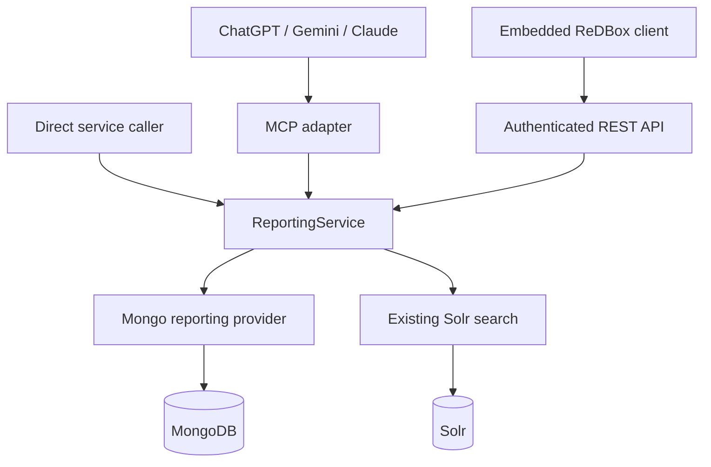

# AI reporting and MCP

ReDBox provides a typed, permission-aware ReportingService in `packages/redbox-core`. Direct application callers, the REST API and the optional `@researchdatabox/redbox-mcp` hook use the same engine. MongoDB supplies structured analytics; existing Solr infrastructure supplies literal full-text discovery. No model-generated database query is executed.



The first milestone supplies schema discovery, counts, up to three grouping dimensions, UTC date histograms, filters, numeric opt-in metrics, literal phrase search and authorized record drilldown. It does not require a particular AI provider. Full-text queries combined with Mongo analytics, exports, and an embedded model interface are future work.

## Enable reporting

Both `reporting.enabled` and `mcp.enabled` default to false. Install/build the MCP hook only for deployments that need it; it is already included in this repository's dependency graph and Docker build. Customer hooks register configuration and forms with `defineRedboxHook`; local/environment overrides follow the normal configuration precedence. Do not edit generated Sails shims.

1. Enable `reporting.enabled` and retain or reduce its configured limits.
2. Add an enabled `reporting` block to the existing record type. Supply `allowedRoles`, optional `searchCore`, explicit form coverage, and explicitly enabled semantic fields.
3. Confirm that each metadata path belongs to the caller's effective **view** metadata contract in every covered form. Test schema discovery with each reporting role.
4. For external clients, configure institution OAuth as described below, then enable `mcp.enabled`.

See [the typed example](../../packages/redbox-mcp/examples/reporting-config.ts). A typical block is:

```ts
reporting: {
  enabled: true,
  allowedRoles: ['Researcher', 'Librarians', 'Admin'],
  forms: ['rdmp-reporting-view'],
  searchCore: 'default',
  fields: [
    { id: 'created', label: 'Created date',
      description: 'Creation date; UTC ranges include start and exclude end.',
      path: 'metaMetadata.createdOn', type: 'date', operations: ['filter', 'histogram', 'read'] },
    { id: 'faculty', label: 'Faculty', description: 'Faculty responsible for the plan.',
      path: 'metadata.faculty', type: 'category', operations: ['filter', 'group', 'read'] },
    { id: 'workflowStage', label: 'Workflow stage',
      path: 'workflow.stage', type: 'category', operations: ['filter', 'group', 'read'] },
  ]
}
```

The example form is illustrative: align its paths, form name and workflow coverage with the customer's authoritative RDMP forms. Existing RDMPs may store faculty elsewhere. Nested scalar paths work; arrays of category strings support grouping and filtering. Arrays of objects and multiple array grouping dimensions are outside this milestone.

Metadata is never automatically enabled by a form or Solr schema. Forms supply a visibility check for explicitly registered fields, not a list of all fields to publish. `enabled: false` disables a field; `allowedRoles` can further restrict it. Descriptions and labels are administrator-controlled semantic guidance. Paths, role restrictions and disabled fields are absent from public schema responses. Authorization, audit, integration and other internal paths cannot be registered. The only permitted paths outside `metadata` are `metaMetadata.createdOn` and `workflow.stage`.

Some view components transform into display-only content with no metadata model. Those paths are conservatively excluded from reporting, even if a rendered HTML component displays them. The example retains model-bearing view fields explicitly. Schema discovery uses the static, role-pruned view contract. Forms containing record-dependent question trees (including reusable definitions) are conservatively excluded from metadata reporting in this milestone; date and workflow-stage reports remain available. Other template-only fields have no reportable metadata model. Record retrieval builds the effective form for the actual record. Missing/unusable forms fail closed. There is no raw metadata fallback.

A metadata filter, dimension or metric restricts its aggregate to records whose `metaMetadata.form` is in the configured coverage. Therefore an unfiltered count of visible records can exceed a faculty breakdown if older records use uncovered forms. Schema discovery reports `metadataFormCoverage`; choose complete, compatible coverage or document the subset. System date/stage reports do not require metadata coverage.

## Authorization

Every provider requires a ReportingPrincipal containing a brand, persisted effective user and populated persisted roles. Public clients cannot supply any part of it. REST refreshes the session/API-authenticated user ID. MCP maps a verified institution access-token identity to an existing OIDC user, refreshes linked-account identity and roles, and uses the deployment's configured brand. Disabled users and unresolved linked aliases cannot report.

All Mongo pipelines match tenant, record type and current record ACLs before filtering or grouping. Record visibility follows RecordsService: either view **or edit** username permission, or either view **or edit** role permission. Role names resolve through the active brand's canonical roles; membership uses role IDs. There is no implicit administrator bypass. Pending invitations do not grant access. Record-type and field reporting roles are additional requirements. REST access also passes through `auth.rules` in `auth.config.ts`: the default reporting paths admit Researcher and Librarians, with Admin admitted by the generic API rule. If `reporting.allowedRoles` includes a custom role such as Reviewer, add an equivalent reporting-path rule for that role in the deployment configuration; changing `allowedRoles` alone does not grant REST route access. MCP uses its own verified-token boundary.

Consequently, ten visible Faculty A records and five inaccessible Faculty A records produce **Faculty A = 10**. Cross-brand records never contribute. Aggregate permissions come from authoritative Mongo records, not index facets. `get_record` and drilldown call RecordsService's view authorization before applying the existing form projection and returning registered `read` fields only. No raw record, permission list or metadata subtree is returned. Reporting's view projection can be stricter than the editable browser form.

Solr discovery applies tenant/type/ACL filters and quotes user text as a literal phrase. Current RecordsService permissions are rechecked for every hit, including the lookahead used to determine truncation. Index totals are omitted (`total: null`) because stale index permissions cannot safely establish an authoritative count. Pages can be short when stale/deleted hits are discarded; offsets refer to index candidates. `truncated` is true when an additional authorized hit is found, otherwise null because completeness is unknown. No inaccessible hit count or presence flag is exposed. Full-text discovery follows the deployment's existing `full_text` indexing semantics.

## Queries and drilldown

Discover fields first with `get_reporting_schema({recordType: 'rdmp'})`. MCP tools accept semantic IDs only:

| Tool | Example arguments |
| --- | --- |
| `count_records` | `{recordType:'rdmp', filters:[{field:'created',operator:'between',start:'2026-01-01',end:'2027-01-01'}]}` |
| `group_records` | Same filters, plus `groupBy:['faculty']` |
| `time_series` | `{recordType:'rdmp',dateHistogram:{field:'created',interval:'month',start:'2026-01-01',end:'2027-01-01'}}` |
| `group_records` | `{recordType:'rdmp',groupBy:['workflowStage']}` |
| `search_records` | `{recordType:'rdmp',text:'machine learning'}` |
| `list_records` | Same aggregate filters, plus `{field:'faculty',operator:'eq',value:'Faculty A'}` for a selected group |
| `get_record` | `{recordType:'rdmp',oid:'<returned-oid>'}` |

Filters support scalar equality, bounded `in`, date `between`, and `missing`. Filters combine with AND. `missing: true` matches missing/null values; false excludes them. Dates accept calendar dates or ISO timestamps with explicit timezone. Date `eq` and `in` compare exact instants; a calendar date means midnight UTC, not the entire day. To match a day, use `between` with that date as start and the following date as the exclusive end. All ranges include start and exclude end; use **2027-01-01** to include all of 2026. Histograms return occupied UTC day/month/year buckets. Compare years with two counts or a yearly histogram.

Grouping defaults to a count. Numeric fields must explicitly allow `sum` or `average`:

```json
{"operation":"group","recordType":"rdmp","groupBy":["faculty","workflowStage"],
 "metrics":[{"operation":"count"},{"operation":"sum","field":"funding","id":"totalFunding"}],
 "sort":{"by":"count","direction":"desc"},"pagination":{"limit":20,"offset":0}}
```

The field registry must enable `funding` for this example. Missing/malformed scalar dimensions form a null group. Numeric sums ignore missing/non-numeric values; averages use numeric values only. One category-array dimension counts a record once per distinct string value, with a null bucket for missing/empty arrays; group counts can add up to more than the number of records.

Results include `total`, `returned`, `offset`, and `truncated` for paging. Group totals count groups, record totals count authorized records. A result exceeding the byte limit fails explicitly; it is never silently cut. Repeat requests with bounded offsets to retrieve additional pages. Counts and pages use live data, not a persistent reporting snapshot; concurrent record updates can change successive results.

## Direct and REST access

Direct callers use server-owned authentication context, not an object supplied by a client:

```ts
const principal = await resolveReportingPrincipal(authenticatedBrandName, authenticatedUserId);
const count = await ReportingService.count(principal, {
  recordType: 'rdmp',
  filters: [{field:'created',operator:'between',start:'2026-01-01',end:'2027-01-01'}]
});
```

Registered REST contracts are:

- `GET /:branding/:portal/api/reporting/schema/:recordType`
- `POST /:branding/:portal/api/reporting/query`

The POST body is the same typed DSL with `operation` (`count`, `group`, `time_series`, `records`, `search`, `get_record`). They use existing ReDBox authentication, role policy, request validation, CSRF/session conventions and versioned response envelopes. Normal API version negotiation can select v2; these are not a separate `/api/v2` routing tree. Existing OpenAPI generation includes the endpoints. An eventual embedded client can call this API using its current authenticated ReDBox session.

## Institution OAuth and remote MCP

The MCP hook exposes `/mcp` through stateless Streamable HTTP and `GET /.well-known/oauth-protected-resource/mcp` for protected-resource discovery. It is a resource server; it does not operate an authorization server or central customer service.

Configure the institution authorization server for authorization-code flows with PKCE S256, client registration suitable for the chosen MCP clients, appropriate consent, the `redbox.reporting` scope, and an access-token audience of **exactly** `https://redbox.customer.edu.au/mcp`. Publish OAuth/OIDC authorization-server discovery and JWKS. Existing customer OIDC issuer/claim mappings can be reused if that issuer supports this resource/audience and clients. Browser OIDC login configuration alone does not create those capabilities.

ReDBox configuration requires:

- HTTPS `resourceUrl` ending in `/mcp`, exact `issuer`, and trusted `jwksUrl`.
- A fixed existing `brand`, required `scope`, and an `identityClaim` matching the existing OIDC username convention (for example `preferred_username`), including the same lowercase setting if used.
- Allowed signing algorithms (`RS256`, `ES256`, `PS256`), optional explicit browser origins, and request byte limit.

Every protocol request authenticates independently. Tokens require verified signature, issuer, intended audience, expiry, issued-at and subject, plus scope and an explicit access-token indicator (`at+jwt`, or a Bearer/access claim for generic JWTs). ID tokens, opaque tokens, proprietary ReDBox API keys, cookie-only remote access and caller role claims are rejected. No account provisioning or email-based matching occurs. Opaque-token introspection and additional identity providers need a separate reviewed authentication adapter; leave the endpoint disabled until the institution meets this boundary.

Unauthenticated calls receive a Bearer challenge pointing to protected-resource metadata. Tokens are never forwarded to another backend. TLS may terminate at a reverse proxy: preserve the configured public **Host**, forward authorization, route both endpoint and metadata, and retain ReDBox's same-origin/explicit-origin checks. The first milestone's external endpoint is at the root `/mcp`; deployments using another application root need corresponding proxy routing, not a different `resourceUrl` path. Clients that obtain OAuth tokens can use the endpoint; product-specific connector availability and client-registration compatibility depend on the institution/client configuration.

Run [the official SDK client example](../../packages/redbox-mcp/examples/client.ts) with `REDBOX_MCP_URL` and a securely supplied `REDBOX_MCP_ACCESS_TOKEN`. It demonstrates the milestone tools without logging the token. This example uses a previously obtained access token; OAuth acquisition is performed by the institution/client, not a custom ReDBox API-key flow.

Protocol references: [official TypeScript SDK](https://github.com/modelcontextprotocol/typescript-sdk), [current MCP authorization specification](https://modelcontextprotocol.io/specification/2026-07-28/basic/authorization).

## Limits, audit and indexes

Defaults: page size 100, groups 100, offset 10,000, filters 20, dimensions 3, date range 3,660 days, Mongo timeout 5 seconds, search results 50, output 64,000 bytes; default requested page size is 20. Administrators can reduce limits. Validation caps increases (timeout at most 30 seconds, output at most 1 MB). Mongo uses `allowDiskUse: false`; Solr uses its query deadline and a bounded HTTP timeout. Overlarge results fail with `LIMIT_EXCEEDED`; unavailable providers fail closed.

ReportingService emits structured `reporting` events with user/brand IDs, source channel, MCP tool, record type, semantic fields, operation, elapsed time, returned/count result size and success/error code. Authentication failures emit safe `mcp-auth` events. SDK input-validation failures also emit reporting failure events; malformed/oversized HTTP bodies emit `mcp-request` events without their contents. Do not enable request middleware that logs bearer headers or returned metadata. Service logs omit prompts, search phrases, filter values, record contents and backend error messages. Use the deployment's existing namespaced logging/retention configuration.

Mongo storage adds one compound `reporting_brand_type_created` index on tenant/type/creation. Existing OID and single-field indexes remain useful. Date filters use `$convert` because deployed records can mix ISO strings, offset timestamps and BSON dates: the tenant/type prefix can narrow the scan, but the converted date predicate will not generally use the date range part of that index. Inspect representative data rather than assuming date index coverage.

An administrator can use `explain('executionStats')` against a pipeline produced by `compileReportingPipeline` in trusted development code. The pipeline must include an actual authenticated test principal; no public explain or pipeline tool is exposed. Compare documents/keys examined and execution time for realistic authorized users and covered forms. Consider compound tenant/type/form/dimension indexes for frequently configured scalar reports and ACL indexes for the deployment's username/role branches. Avoid compound indexes containing multiple array fields (parallel-array multikey restrictions), and do not automatically create customer-specific dimension indexes. Test size/timeout settings under realistic load before enabling reporting.

## Verification

For a ready-to-run Tailscale environment with a local Keycloak OAuth realm, fictional RDMPs and ChatGPT Work connection instructions, see [the reporting demo guide](../development/mcp-reporting/README.md).

Compile server packages with `npm run compile:server` (or core, MCP and storage independently). `npm run test:reporting` runs isolated Mongo and the core/MCP conformance suites using the built test image. Build that image from the current checkout with `docker build --target test -t redbox-portal:test .`, then run `RBPORTAL_IMAGE=redbox-portal:test npm run test:reporting`. Rebuild it after implementation changes: the suite mounts checkout tests, while implementation and compiled packages come from the image. `RBPORTAL_IMAGE` is required and Compose never pulls the reporting test image, preventing an implicit fallback to the published `develop` image. CI already supplies `RBPORTAL_IMAGE=redbox-portal:test` and runs this target in the existing Mocha job.

For an already available isolated Mongo endpoint:

```bash
REDBOX_REPORTING_MONGO_URL=mongodb://127.0.0.1:27017 npm run test:reporting:local
```

Tests cover current ACLs, cross-brand isolation, the 10-visible/5-hidden faculty case, query injection and validation, actual Mongo aggregates/dates/arrays/pagination, real view-form projection, refreshed identity, REST adaptation, literal Solr queries, official MCP discovery/tools/HTTP, JWT validation, safe errors and output limits. Each Mongo suite creates and removes only its own UUID-named database. No database is seeded or mutated by enabling reporting.
